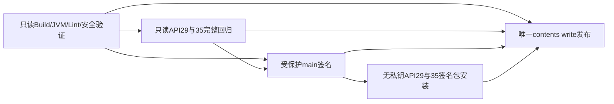

# Public 仓库 CI/CD 安全边界

本轮只改工作流、CI脚本、测试和本文档。基线 main `e4e311a81460b4abfbf282851c2c4c8d05831834`，V2 PR #10 已合并。App源码、财务公式、数据库/备份业务格式、包名和版本均不改。

## 原流程审查

| 事件/任务 | 原行为与风险 |
| --- | --- |
| PR、main push、任意分支手动 | 同一个build，检出PR head或事件SHA，build拥有contents:write |
| build签名步骤 | 无事件隔离，直接引用四个长期签名Secrets；同仓PR不能依赖Fork默认不提供Secrets来保护 |
| API29/35 | 依赖build，下载wrapper、Room报告、RC和可选固定签名包；签名失败后仍尝试完整回归 |
| publish | build和device成功后，同仓PR也能进入contents:write发布Job；非main手动也未排除 |
| Artifact | RC、同一APK的分片、wrapper、签名元数据、构建报告、两套截图包、两套包含相同截图的原始报告均保存30天 |
| Release | 每个运行/尝试建新tag，并重复上传截图ZIP与单张PNG |

原流程未使用pull_request_target。原V0.3证书pin不变：`30d5e88ac7f0ade3d8c5f10d7d894681e7953002377c85b5fa094ee7b71e071c`。

## 新依赖和权限

PR和非main手动只走B/D，始终能下载隔离RC Artifact。签名与发布的表达式同时要求本仓库、push或workflow_dispatch、refs/heads/main、构建/完整模拟器矩阵成功。Python入口再验证事件、workflow_ref、事件SHA=源码SHA，并核对git实际检出SHA。没有pull_request_target、workflow_run、外部产物输入或用户指定源码SHA。

所有checkout均persist-credentials:false；全局和普通构建contents:read，设备/签名还需要actions:read以读取本次Artifact。只有publish声明contents:write。第三方Actions固定完整40位commit；actionlint固定版本及SHA-256。PR Gradle缓存只读，main可写；编译缓存复用，但JVM Test输出不使用up-to-date或build-cache，确保每轮执行测试体。API29/35不删测试，fail-fast:false，保留超时、并发取消、启动ANR拒绝及失败证据。

## 长期私钥必须使用外部保护

仅靠仓库内YAML无法建立对“能修改同仓工作流且拥有仓库写权限者”的绝对安全边界。Repository Secrets可被同仓恶意工作流直接引用；默认只读Token设置也不是不可更改的权限上限。CI安全测试能检测本PR的批准配置，不能阻止攻击者在另一个工作流里删掉检查。

因此在配置任何长期私钥之前，所有者必须完成：

1. 创建Environment `v03-signing-main`，Deployment branches/tags选择Selected branches and tags，只添加类型Branch、名称严格为main的一项；不允许tag main、通配符或PR ref。
2. 把原四个`TRADE_REVIEW_KEYSTORE_BASE64`、`TRADE_REVIEW_KEYSTORE_PASSWORD`、`TRADE_REVIEW_KEY_ALIAS`、`TRADE_REVIEW_KEY_PASSWORD`放在这个Environment；原证书pin作为公开Variable `TRADE_REVIEW_UPGRADE_CERT_SHA256`。不重新生成私钥。
3. 移除同名Repository Secrets及任何可供PR读取的签名副本；不要把私钥放普通Variables。必须由所有者在可信设备自行完成，Codex不代传或读取。
4. 建议配置Environment required reviewer、关闭管理员绕过。只有一个管理者时，防止自己审批可能导致自己发起的运行无人能审批，需按实际管理人员设置。
5. 建议为main启用PR合并、必要状态检查及CODEOWNERS审核，限制直接推送。新CODEOWNERS文件只有在所有者启用对应保护后才有强制效果。不要给不可信贡献者仓库写权限；公开贡献使用Fork PR。开启GitHub secret scanning/push protection。

代码只读取既有Environment及分支规则；缺失、403或规则不严格均不进入签名Job，也不自动创建Environment。进入后在加载密钥的步骤之前再次检查保护并验证全部原始测试和未签名输入。不能读取Secrets真实值的API不被伪装成配置成功。

签名Job不运行Gradle、不从Artifact执行脚本；只给已验证unsigned APK和公开模拟器测试fixture签名。临时密钥文件位于runner临时目录，0600，finally删除，异常不输出私有诊断。签名后使用apksigner核对原pin，并逐项比较签名APK与已验证未签名APK的应用payload。固定包在无Secrets的API29/35任务中真实安装；手动提供原签名旧公开APK时才做真实install -r与合成数据保留验证。缺旧APK明确未执行，不用临时签名冒充。

缺少全部Secrets时仅RC；部分Secrets、错误证书、固定包安装失败均拒绝发布，不降级掩盖错误。所有包仍为prerelease候选，真机验收和稳定发布另行决定。

## 产物流与保留

| 新Artifact | 消费方 | 保留 |
| --- | --- | --- |
| rc-apk-attemptN：一份RC、身份、内部SHA清单 | API29/35、可信签名/发布、手机手动下载 | 7天 |
| build-evidence-attemptN：JVM原始XML、三种Lint XML、生成Room schemas、上下文 | API29/35、可信签名/发布 | 7天 |
| signing-inputs-attemptN：unsigned Release与公开测试APK，仅可信main创建 | 签名 | 3天 |
| device-evidence-api29/35-attemptN：原始XML、每项指标一份、截图一份、SHA清单 | 签名、发布 | 7天 |
| signing-result-attemptN：观察到的状态、可选固定签名APK/公开fixture，无私钥 | 签名安装、发布 | 3天 |
| signed-install-api29/35-attemptN | 发布 | 7天 |
| build/device/signed-install failure诊断 | 人工排错，不作为成功证据 | 3天 |

取消重复APK分片、wrapper Artifact（wrapper已在Git中）和独立截图Artifact。成功流程的原始Android HTML/logcat/数据库副本不重复上传，失败时保留。Room生成schema和全部测试XML仍保留。没有删除历史Release、APK、Artifact或迁移源码。

下载仅允许当前run、相同source SHA/仓库；验证GitHub服务端Artifact ZIP SHA-256、限额/安全路径解压、内部清单、每文件大小和SHA，并与build Job输出的manifest SHA比对。接收目录与源码目录分离，不能覆盖签名脚本。拒绝跨运行Artifact、符号链接、重复/非法路径、缺失文件、额外文件、错误SHA。失败的API矩阵不会到达发布，重试选最新成功证据，不能以旧绿色替代本次失败。

可信main Release持久保存APK、SHA、身份/签名状态、CI-RESULTS、来源收据、指标、截图ZIP，以及紧凑CI-EVIDENCE.zip（原始JVM/设备XML、Lint、Room schemas），避免唯一迁移证据仅存在短期Artifact。截图只放ZIP，不再重复上传全部单张PNG。tag为`v200-ci-rc-完整源码SHA`或`v200-ci-fixed-完整源码SHA`；同一源码/身份通道重跑不覆盖或重复发布。RC后补齐固定身份可有独立fixed候选，不把RC标成稳定版。

## 实际检查范围与待办

本轮环境审查：仓库Public、main基线合并已确认；GitHub API显示main未受保护，Environment列表为空。Secrets/Variables名称以及默认Token权限管理接口返回403，不能据此声称不存在Secrets或已安全迁移。未读取任何长期私钥或密码，未修改GitHub保护设置。

本地安全用例覆盖实际YAML条件、同仓/Fork PR、main push/main手动、非main手动、失败/取消/跳过矩阵、缺Secrets、环境分支策略、原pin错误、Artifact缺失/篡改/跨运行/非法ZIP、私钥步骤提前拒绝和发布白名单。原50项安全/签名/启动回归保留，actionlint实际执行。最终计数及Actions真实运行链接以本PR验证记录为准，不把条件模拟当成真实main签名。

新流程尚未合并时，main push/选择main手动仍使用旧main工作流。为遵守“不自动合并”，本轮可以实际执行PR及开发分支手动路径；新main路径需所有者合并后实测。不能把旧main的运行、单元测试事件矩阵或非main手动运行冒充新main发布成功。原私钥/受保护环境未就绪时，固定签名与原证书升级均未执行。

## 仅安卓手机操作

1. 审核本PR的完整Android CI，再自行决定合并。不要在聊天、Issue、PR或Artifact发送keystore和密码。
2. 配置签名前先在仓库Settings → Environments完成上述main专用保护，迁移Secrets并移除Repository副本；手机可切换浏览器“桌面网站”。没有原V0.3 keystore时保持RC，不建立替代身份。
3. Actions → Android CI → Run workflow。未合并前选择codex/public-ci-security，只会构建测试，不签名或发布。合并后选择main，必须等待build和两个API全部绿色；保护/密钥未就绪则跳过固定签名，只允许RC候选。
4. 若需真实原签名升级验证，在main手动运行输入原固定证书公开Release tag及精确APK文件名。只接收本仓库公开文件名，不输入路径、URL、通配符或秘密。
5. PR/nonmain运行：在完成页面Artifacts下载rc-apk-attemptN ZIP，解压取APK；需登录GitHub，7天后过期可重跑。可信main成功发布：从Releases下载APK、SIGNING.txt、SHA256SUMS.txt、CI-RESULTS.txt和CI-EVIDENCE.zip。仅使用Release中明确标记的身份，不认为隔离RC可以覆盖旧应用。
6. 测试失败查看对应build/API29/API35及failure诊断，修复后Re-run failed jobs。系统启动ANR不得忽略。相同源码已有候选时保留首个已验证Release，不使用覆盖上传。

在所有者完成Environment、Repository Secrets清理及分支保护前，本PR只能证明批准工作流的隔离逻辑；不能宣称公开仓库任何可修改工作流的写权限主体都被绝对隔离。
